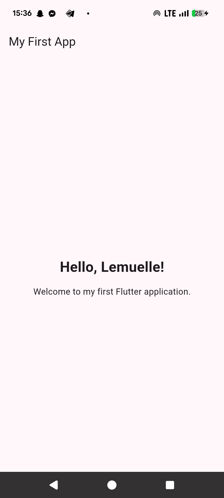
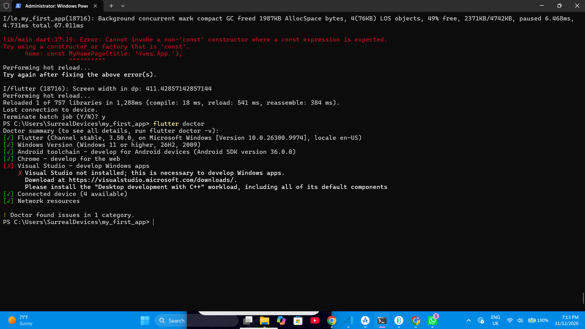

Flutter Lab 1 – My First Flutter Application

1. Introduction

This exercise was designed to introduce me to Flutter and mobile application development. The main objective was to set up a Flutter development environment, create my first Flutter application, understand the basic structure of a Flutter project, and run the application on an Android device.

The exercise also introduced me to Visual Studio Code, Git, and GitHub for source code management and version control.

2. Objectives of the Exercise

The main objectives were to:

- Install and configure the Flutter SDK.
- Set up Visual Studio Code for Flutter development.
- Create a new Flutter project.
- Understand and modify the "main.dart" file.
- Use basic Flutter widgets such as "MaterialApp", "Scaffold", "AppBar", "Text", and "Column".
- Use "MediaQuery" to obtain screen dimensions.
- Use "debugPrint()" to display information in the debug console.
- Run the application on an Android device.
- Use Git and GitHub to track and share the project.

3. What I Successfully Accomplished

Despite the challenges encountered, I successfully accomplished the main tasks of the exercise.

My achievements include:

- Successfully installed and configured the Flutter SDK.
- Verified the Flutter installation.
- Configured Visual Studio Code for Flutter development.
- Created my first Flutter project named "my_first_app1".
- Successfully retrieved project dependencies using "flutter pub get".
- Modified the "main.dart" file to customize the application's interface.
- Added a personalized greeting: "Hello, Lemuelle!"
- Used "MediaQuery" to retrieve screen dimensions.
- Used "debugPrint()" to display information during execution.
- Configured my Google Pixel for USB debugging.
- Used Git and GitHub to manage and push my project.

Most importantly, I finally succeeded in running my first Flutter application.

4. Difficulties Encountered

During the exercise, I encountered several difficulties:

a. Hardware Limitation – My Personal Computer

The very first challenge was related to my computer. Unfortunately, my personal laptop was not in good working condition, which prevented me from using it to complete the exercise.

As a result, I had to borrow my classmate's laptop to continue working.

b. GitHub Access and Collaboration

Since I was using my classmate's laptop and his Visual Studio Code environment, I also faced a challenge with pushing my work to GitHub.

To solve this problem, I had to add my classmate as a collaborator to my GitHub repository so that I could use his VS Code environment to push my project successfully.

This experience helped me understand GitHub collaboration and repository permissions.

c. Flutter SDK Configuration

I initially experienced difficulties configuring the Flutter SDK and ensuring that the system could recognize Flutter commands correctly.

d. Dependency Management

I encountered issues with Flutter dependencies and unresolved imports in Visual Studio Code. I had to run "flutter pub get" and check the project configuration.

e. Android Device Detection

Connecting my Google Pixel to the computer was another challenge. I had to enable Developer Options, activate USB Debugging, and authorize the computer to communicate with my phone.

f. Gradle Build Errors

When I first attempted to run the application, the Android build process failed with a Gradle error:

"Gradle task assembleDebug failed with exit code 1"

I also encountered access permission and Flutter engine initialization errors. These required additional troubleshooting before I could successfully run the application.

5. Lessons Learned

This exercise taught me that software development involves more than writing code. It also requires access to appropriate hardware, proper configuration of development tools, dependency management, debugging, collaboration, and version control.

I improved my ability to:

- Work with the Flutter framework.
- Understand the structure of a Flutter project.
- Identify and troubleshoot technical errors.
- Connect a physical Android device for application testing.
- Use Git and GitHub for version control.
- Understand GitHub collaboration and repository permissions.
- Adapt to unexpected situations and find alternative solutions.
- Remain patient and persistent when facing technical challenges.

6. Conclusion

Although I encountered several challenges, starting with the failure of my personal laptop, I did not give up.

I had to adapt by using my classmate's computer, configuring the development environment, resolving GitHub access issues, and troubleshooting several technical errors.

Through persistence, collaboration, and practice, I finally succeeded in completing the exercise and running my first Flutter application.

This experience was an important first step in my journey toward becoming a mobile application developer. It taught me not only technical skills but also problem-solving, adaptability, and collaboration.

Exercise Status: Successfully Completed!